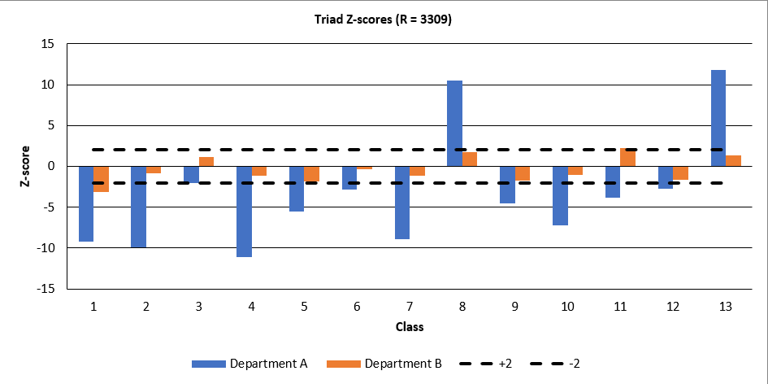

CS1005 Discrete Structures - Fall 2026 Project
Finding Network Motifs in an Email Network

Group R = 3309

Group Members
- Farwa Fatima - 2 (Member 1 - Dataset & Parameters)
- Ayesha Hassan- 25i0800 (Member 2 - Subgraphs & Classification)
- [Name 3] - [Roll Number 3] (Member 3 - Counting & Randomization)
- Manaal Mehtab - 25k-0960 (Member 4 - Analysis & Results)

Derived Parameters
- R: 3309
- Pair Number: 79 -> (4, 14)
- Department A: top20[4] = ID 1
- Department B: top20[14] = ID 5
- Number of Random Networks: 43
- Swap Attempts: 8 × edges
- Random Seed: 3309

How to Run
1. Run Member 1's notebook to generate clean_edges.csv and department_labels.csv.
2. Run Member 2's Python script to generate the induced subgraphs and classifications.
3. Run Member 3's Python script for counting and randomization.
4. Run Member 4's Python script for the Z-scores (T6). The T7 chart is made in Excel from member4_z_scores.csv (member4_T7_chart.xlsx).

---

Task 1 (Member 1's Contributions)
- Downloaded and loaded the email-Eu-core.txt and email-Eu-core-department-labels.txt datasets.
- Preprocessed the data by removing all self-loops and duplicate edges, resulting in 24,929 clean edges.
- Calculated the number of internal edges for all 42 departments.
- Generated the Top-20 department ranking based on internal edges.
- Calculated R = 3309 and all derived parameters (Pair number: 79, Dept A: 1, Dept B: 5, Random networks: 43, Swap multiplier: 8, Seed: 3309).
- Deliverables: Member1_Dataset_Parameters.ipynb, clean_edges.csv, department_labels.csv, top20_departments.csv, parameter_report.csv, and the extracted department node/edge CSV files.
---

Task 2 & Task 3 (Member 2's Contributions - My Work)

Induced Subgraphs (T2)
We created the induced subgraphs for Department A (ID 1) and Department B (ID 5).
- Department A: 65 Nodes, 502 Internal Edges
- Department B:18 Nodes, 147 Internal Edges

Hand-Worked Example (T3 - Class 1, Canonical Code 3)
Let's classify a triad where Node a sends emails to Node b and Node c (edges a->b, a->c).
1. Order (a, b, c): a->b is Bit 0, a->c is Bit 1. Code = 3.
2. Order (a, c, b): a->c is Bit 0, a->b is Bit 1. Code = 3.
3. Order (b, a, c): No matching edges. Code = 0.
4. Order (b, c, a): No matching edges. Code = 0.
5. Order (c, a, b): No matching edges. Code = 0.
6. Order (c, b, a): No matching edges. Code = 0.
The minimum code across all 6 permutations is 3. According to the project statement, Code 3 maps to Class 1.

Triad Classification Function (T3)
We implemented triad_class(a, b, c) in Python, which generates the canonical code for any given triad by checking all 6 node permutations and mapping the minimum code to one of the 13 connected classes. We included a 4-test verification function in the code which successfully passes.
Deliverables: Python code for subgraphs and triad_class, and hand-worked example.

---

Task 4 & 5 (Member 3's Contributions)

* T4 – Triad counting: counted all 13 connected triad classes in both real subgraphs (Department A, ID 1, and Department B, ID 5). For every node, all pairs of its neighbours (in either direction) are enumerated and each triple is stored as a sorted tuple in a set, so every connected 3-subset is counted exactly once. This avoids looping over all C(|V|,3) subsets.
* Checked the counts against a brute-force loop over every 3-subset (in code, `verify_counts_bruteforce`); both agree for both departments.
* T5 – Implemented `randomize(edges, attempts, seed)` using double-edge swaps: two edges (a,b) and (c,d) are chosen uniformly at random and replaced by (a,d) and (c,b). An attempt is rejected if a = d, c = b, (a,d) or (c,b) already exists, or the same edge is picked twice. Rejected attempts still count as attempts, and every random network starts from the original graph.
* Verified with assertions that every node's in-degree and out-degree is unchanged, the edge count is unchanged, and there are no self-loops or duplicate edges, for all 86 random networks (43 per department).
* Generated the 43 random networks per department. Network k (k = 0..42) uses seed R + k, so networks differ but the run is reproducible.
* Why swaps keep degrees: (a,b) and (c,d) become (a,d) and (c,b). The sources a and c still send one edge each and the targets b and d still receive one edge each.
* Deliverables: `member3.py`, `member3_T4_triad_counts.csv`, `member3_random_network_counts.csv`.

---

Task 6, 7 & 8 (Member 4's Contributions)
* T6 – Computed the mean and population standard deviation (divide by 43; Z = 0 if the standard deviation is 0) over the random networks, and the 13 Z-scores for each department. Z > 2 is a motif and Z < −2 is an anti-motif.
* Results: Department A has motifs 8 and 13 and anti-motifs 1, 2, 4, 5, 6, 7, 9, 10, 11, 12 (class 3 has Z = −1.999, just inside the threshold, so it is neither). Department B has motif 11 and anti-motif 1.
* Observed triad counts (T4): Department A: 443, 174, 1074, 91, 59, 189, 266, 740, 1, 50, 61, 370, 385. Department B: 8, 20, 61, 12, 11, 22, 39, 62, 0, 28, 29, 105, 78.
* T7 – Created the grouped bar chart in Excel from the T6 Z-scores (`member4_z_scores.csv`): x = classes 1–13, two bars per class (Department A and Department B), with dashed lines at +2 and −2. The chart title includes R = 3309. The figure is saved as `chart.png` and shown below.
* T8 – Wrote the comparison of how the two departments communicate differently and which motifs explain it. This paragraph was discussed and written together by all members.
* Deliverables: `member4.py`, `member4_Z_table_A.csv`, `member4_Z_table_B.csv`, `member4_z_scores.csv` (T6), grouped bar chart (`member4_T7_chart.xlsx`, `chart.png`, T7) and comparison paragraph (T8).

---

Z-score Chart (T7)

---

Comparison of Communication Patterns (T8)

Department 1 (A) and Department 5 (B) communicate in quite different ways. Department A has two motifs, class 13 and class 8. In class 13, all three people email each other in both directions, and in class 8, one person has conversations in both directions with two others who do not email each other. Both patterns are made of replies, so people in Department A often talk back and forth in close groups, and this happens far more than chance would explain (Z = 11.8 and Z = 10.5). At the same time, Department A has ten antimotifs (classes 1, 2, 4, 5, 6, 7, 9, 10, 11 and 12). Simple patterns such as one person emailing two others (class 1) or a plain chain of emails that only go in one direction (class 2) appear much less often than in the random networks. Department B is smaller and looks much closer to random: only class 11 is a motif (Z = 2.25), only class 1 is an antimotif (Z = -3.17), and every other class stays between -2 and 2. Class 11 is a pair of people who email each other both ways, plus a third person who emails both of them but never gets an email back. So Department B has a few cases where one person writes to a pair who already talk to each other. In short, Department A works like a closely connected team where replies are common, while Department B shows no strong pattern apart from these two small differences.
